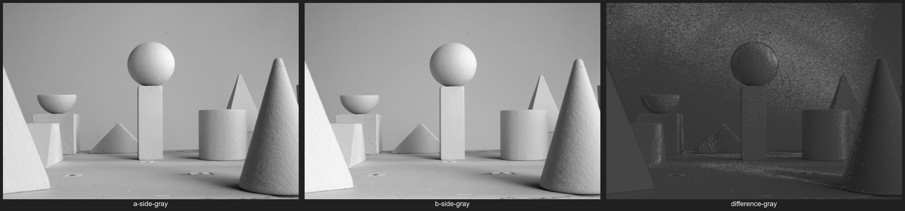
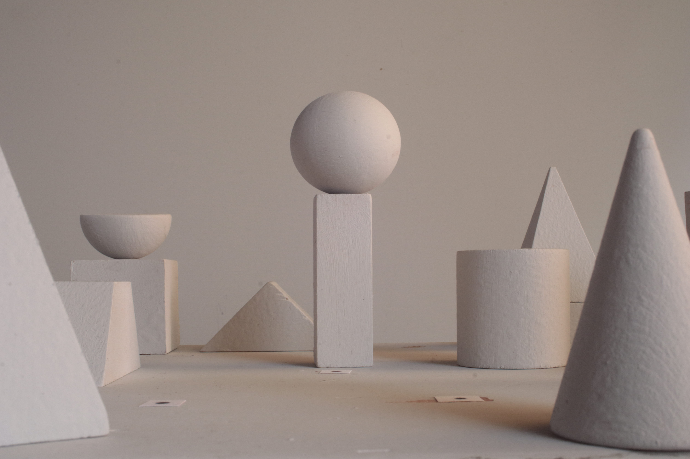
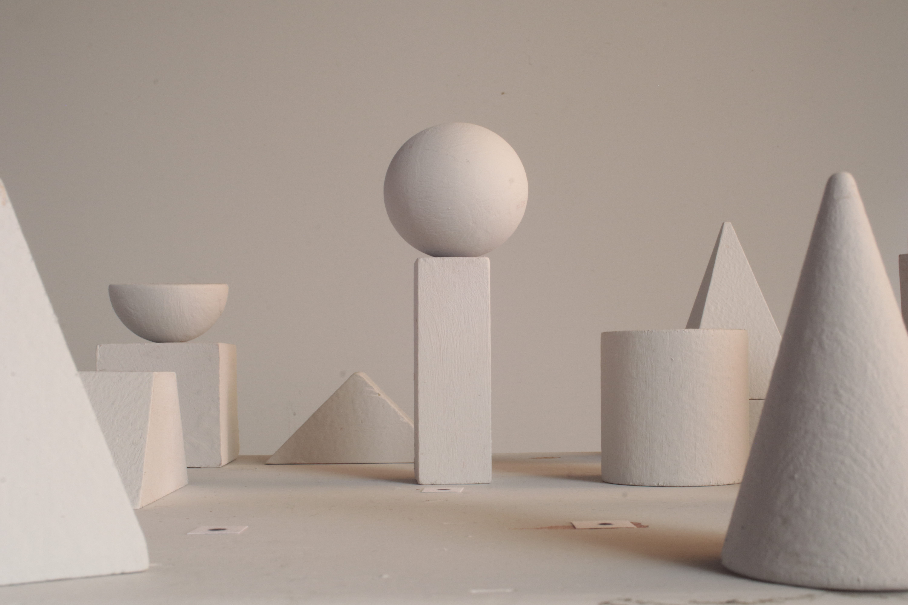

# Test 1 — Camera Recovery

**Status: Visual recovery demonstrated; quantitative accuracy not established**

## Purpose

Record a camera view and TPS reference on one physical setup, move or remove the camera, and use TPS to recover the recorded view on the same setup.

## Procedure

1. Establish and record the original camera view and TPS reference.
2. Capture `original.png`.
3. Move or remove the camera while leaving the physical reference setup in place.
4. Use the TPS overlay and visual comparison to recover the view.
5. Capture `recovered.png`.
6. Create `comparison.png` showing the original, recovered, and grayscale difference images.
7. Complete `measurements.md` with measurements and observations.

## Evidence

The original/recovered registered image comparison is primary. Measurements and
operator observations are supporting evidence.

## Public Test-01 record

This record uses the take-02 evidence. The take-01 comparison is not used.

*Test-01 demonstrates recovery of a recorded camera view after camera
repositioning. Visual recovery demonstrated; quantitative TPS accuracy not
established.*

| Original A-side | Recovered B-side |
|---|---|
|  |  |

- Original A-side: [`tps_001_02_X1_0001.jpg`](../../tps-testing/test-01/a-side/take-02/tps_001_02_X1_0001.jpg)
- Recovered B-side: [`tps_001_02_X1_0002.jpg`](../../tps-testing/test-01/a-side/take-02/tps_001_02_X1_0002.jpg)
- Comparison: [`comparison.png`](../../tps-testing/test-01/a-side/take-02/comparison/comparison.png)
- Difference image: [`difference-gray.png`](../../tps-testing/test-01/a-side/take-02/comparison/difference-gray.png)
- Comparison report: [`comparison_report.md`](../../tps-testing/test-01/a-side/take-02/comparison/comparison_report.md)
- TPS reference data: [`tps_reference.json`](../../tps-testing/test-01/a-side/take-02/tps_001_02_X1_0001.tps/data/tps_reference.json)
- Camera report: [`camera_report.md`](../../tps-testing/test-01/a-side/take-02/tps_001_02_X1_0001.tps/reports/camera_report.md)

### Capture and provenance

- Capture person: Christopher Weinberg.
- Public redistribution of the images and validation materials is approved by
  Christopher Weinberg.
- A-side capture: 2026-10-13 11:58:47 PDT.
- B-side capture: 2026-10-13 12:16:21 PDT.
- Camera: Canon EOS R100.
- Lens and source focal-length metadata: unavailable.
- Public JPEG and generated comparison artifacts were checked for camera
  serial-number metadata. Raw CR3 files, which contain the serial number, are
  excluded from the public evidence set.

### Measurements and TPS values

- A-B base pair: 74 mm.
- A-C side: 87.5 mm.
- B-C side: 79 mm.
- TPS Reference Distance: 304.4 mm.
- Calculated Working Focal Length: 39.680971 mm.
- Camera tilt / roll: 4.6 degrees / 0.7 degrees.
- Normalized raster: 6000 x 4000 px.

The calculation assumes an equidistant A-B base pair, square pixels, an
unknown crop state, no distortion correction, no lens shift, and a sensor-plane
to-reference-plane focus-distance convention. The active sensor is treated as
the full Canon EOS R100 sensor (22.3 x 14.9 mm), based on the manufacturer
catalog entry recorded in the TPS package.

### Recovery and limitations

The operator established the A-side reference, loaded the TPS package as a
Dragonframe overlay, adjusted the physical camera while comparing the overlay
with the B-side view, and inspected the three reference markers and principal
scene objects. The exact operator movement sequence and individual adjustments
were not recorded.

The result demonstrates practical visual recovery for this setup. It does not
establish quantitative TPS accuracy, calibrated geometric residuals, a camera
solve, lens calibration, or multi-view reconstruction.
